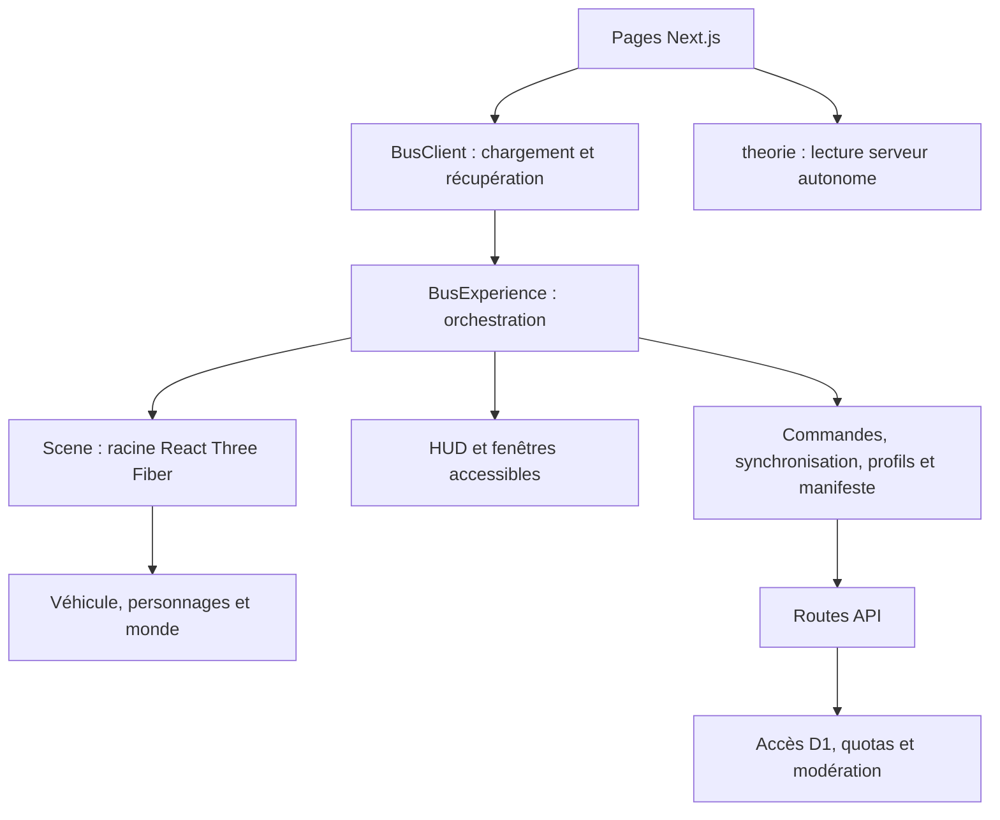

# Architecture du projet

Ce guide décrit les responsabilités actuelles. Les revues datées du dossier
`docs/` sont des archives ; l’[index](README.md) permet de les distinguer.

## Parcours et propriétaires d’état

`BusExperience` conserve la phase du voyage, les compteurs, la rangée de lecture
et les choix des lecteurs. Les modules spécialisés possèdent leurs opérations :

| Module | Responsabilité |
| --- | --- |
| `useBusSync` | Statistiques, profils proches, polling suspendu hors onglet et réessai d’inscription. |
| `usePassengerProfile` | Formulaire, validation, sauvegarde/verrou de mutation, brouillons locaux et annulation au démontage. |
| `usePassengerDirectory` | Manifeste paginé, fiches chargées à la demande, annulations et navigation entre fenêtres. |
| `PassengerDialogs` | Branchement des composants de présentation sur ces deux hooks, sans accès D1. |
| `useBusControls`, `useBusPreferences` | Commandes de conduite et préférences conservées dans le navigateur. |
| `useBusParty` | Début/fin de fête, restitution du lecteur précédent et état de danse. |
| `useModalAccessibility`, `useVisualViewport`, `useHudLayout` | Focus, fond inerte, viewport et placement des commandes. |

L’inscription et l’embarquement restent coordonnés : le contrôleur attend la
place attribuée, puis la caméra rejoint les yeux une seule fois. Les réponses
de statistiques anciennes sont refusées via `profileRevision`. Les composants
de présentation ne gèrent pas directement le réseau ou les secrets.

## Rendu 3D

`Scene` possède le Canvas, le plafonnement à 60 images/s, l’adaptation de la
résolution, les protections WebGL et la suspension hors onglet ou derrière une
fenêtre. Il s’agit d’un plafond, pas d’une garantie de 60 images/s atteintes.

`Bus` assemble et anime le véhicule. Les ressources et sous-ensembles sont
séparés pour pouvoir modifier une responsabilité sans recopier l’habitacle :

- `useBusResources` crée les matériaux, textures Canvas et géométries du chapeau
  et les libère au démontage. Les images chargées par `useTexture` restent
  détenues par le cache Drei.
- `BusExterior`, `BusFront` et `BusDoors` gèrent carrosserie, face avant et portes.
- `BusCabinInterior` possède le revêtement, les lumières et les sièges instanciés ;
  `BusCabinDetails` possède les équipements, anneaux et barres.
- `BusCockpit` assemble les deux sièges avant, le tableau de bord et les guides.
- `Passengers`, `BoardingAvatar`, `BoardingController` et `CameraRig` distinguent
  occupants assis, avatar en mouvement, trajet et point de vue.

Les nouvelles extractions n’ajoutent pas de groupe 3D autour des sous-ensembles :
les coordonnées, noms utiles aux contrôles et matériaux partagés restent les
mêmes. Les calculs de géométrie et de mouvements sont principalement dans
`src/lib/`. Les utilitaires Canvas, YouTube et audio ont besoin du navigateur ;
ils ne doivent pas être exécutés pendant le rendu serveur de `/theorie`.

## Contrat audio entre les racines React

Le Canvas et l’interface ont des racines React distinctes. `src/lib/bus-audio.ts`
centralise les noms DOM, types de payload, abonnements et désabonnements.
Les commandes partent **synchroniquement dans le geste utilisateur**, avant les
effets et requêtes réseau, afin de conserver ce geste jusqu’au lecteur.

La priorité exprimée par `getBusAudioOwner` est : **vidéo de la théorie → fête →
télévision du bus → musique de fond**. Les composants des lecteurs conservent
leurs références et transitions ; ce contrat ne crée pas de lecteur ou de store
global supplémentaire. Les événements historiques sont conservés derrière
l’API typée pour les scénarios de tests existants.

La TV préchauffe un début de vidéo en muet avant l’entrée. Elle n’est audible
qu’une fois l’avatar installé. Le fond est coupé pendant la vidéo, puis reprend
progressivement sans écraser le volume choisi. La danse suit l’horloge réelle
de la fête à partir de huit secondes, y compris après une boucle.

## Serveur et données

Les routes Next.js délèguent les accès D1, la validation et les quotas aux modules
de `src/lib/server/`. Les requêtes SQL sont préparées et les migrations
versionnées. Le navigateur passe par `src/lib/client/bus-api.ts` avec délai,
annulation et identité locale ; il n’importe pas les modules serveur.

Le secret HMAC des quotas et le jeton de suppression administrative sont
distincts. Leur configuration et les parcours de suppression sont documentés
dans le [guide d’exploitation](exploitation.md). Les identifiants d’inscription
ne constituent pas un système de comptes ni une récupération multi-appareils.

## Invariants à préserver

- Trois accompagnateurs permanents ; tous les autres occupants sont de vrais
  inscrits. Aucun avatar supplémentaire par défaut ; deux occupants maximum par
  banquette. L’exploration ne réattribue pas les identifiants enregistrés.
- Visiteurs détaillés limités à huit sur ordinateur ou deux sur appareils
  modestes, puis jusqu’à 160 modèles simplifiés instanciés. Rangées et profils
  éloignés restent bornés ; la longueur logique peut continuer à augmenter.
- Un seul lecteur vidéo réel pour les télévisions du bus ; les écrans secondaires
  sont des cadres légers et le lecteur rejoint la télévision active.
- Une porte et un vestibule supplémentaires toutes les huit rangées, trajet par
  la porte la plus proche et espace libre devant chaque télévision.
- Figer le défilement du décor ne suspend ni les médias ni le trajet du passager.
- Réduire les animations respecte la préférence système ; les tests émulés ne
  prouvent pas l’autonomie, la chauffe ou la fluidité sur un appareil physique.

Les [tests](tests.md) couvrent ces comportements. Lors d’une extraction, garder
les tests de parcours et les invariants ; éviter de contraindre un nom local ou
l’emplacement exact d’une ligne lorsqu’un résultat observable suffit.
