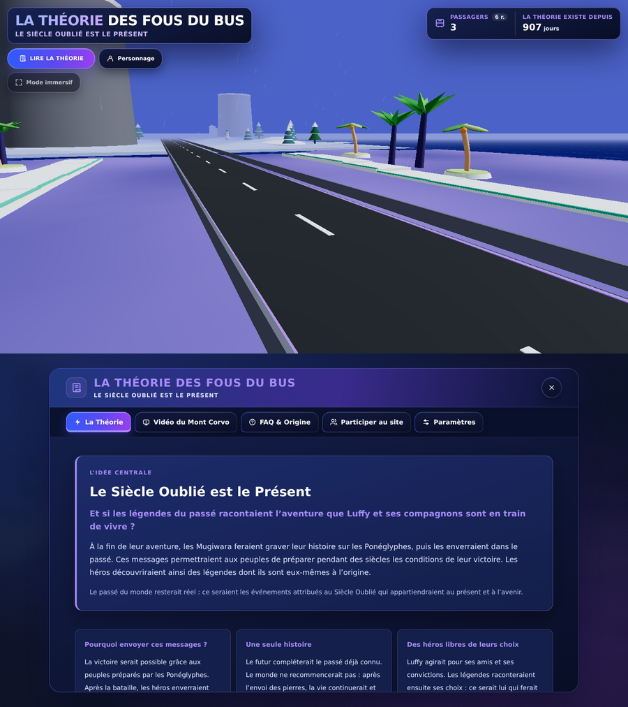

# Direction artistique — bleu → violet



Référence : le bouton **« Lire la théorie »** fourni en image. Un comprimé
allongé, dégradé bleu → violet, texte blanc gras, fin liseré clair, halo doux,
sur un bleu nuit légèrement granuleux. Toute l'interface reprend cette base ;
seule la silhouette du bouton varie légèrement selon son rôle.

## Palette

| Rôle | Valeur |
| --- | --- |
| Départ du dégradé | `#2f5bff` |
| Milieu | `#5a4bf2` |
| Fin du dégradé | `#9a3ff0` |
| Accent texte / bordures | `#a78bfa` |
| Accent au survol / focus | `#c9b8ff` |
| Fond nuit | `#050a1b` |
| Surface principale | `#0b1433` |
| Surface élevée | `#141f4b` |
| Texte | `#ffffff` / `#e2e8ff` / `#b6c1ee` |

Les variables et le grain sont définis dans `src/app/globals.css` (`:root`) :
`--bus-gradient`, `--bus-gradient-border`, `--bus-accent`, `--bus-noise`, etc.
La page d'erreur critique, qui n'embarque pas Tailwind, reprend la même palette
dans son CSS autonome (`src/app/global-error.tsx`).

## Boutons : une famille, plusieurs formes

Tous les boutons utilisent le dégradé (plein pour l'action principale, en
liseré pour les actions secondaires). La forme donne un indice sur la fonction :

| Classe | Forme | Usage |
| --- | --- | --- |
| `.bus-gradient` | comprimé `999px`, dégradé plein, texte blanc, halo | CTA : « Lire la théorie », « Entrer dans le bus », « Choisir ce personnage », onglet actif |
| `.bus-secondary` | squircle `1.15rem`, fond nuit, bordure dégradée | Actions secondaires : « Personnage », « Phares », « Annuler » |
| `.bus-shape-circle` | cercle | Boutons icône : fermer, recentrer, flèches |
| `.bus-shape-tab` | onglet (haut arrondi, bas plus court) | Onglets de la fenêtre théorie |
| `.bus-shape-ticket` | `20px 8px 20px 8px` | « Sortir » et actions destructives |
| `.bus-danger` | dégradé violet → magenta | Confirmation de suppression, retrait |
| `.bus-toggle-on` | anneau intérieur blanc | Interrupteurs actifs (musique, jour/nuit, fête) |

Les états `:hover`, `:active`, `:focus-visible`, `:disabled` et
`prefers-reduced-motion` sont gérés centralement dans `globals.css`. Les cibles
tactiles de 44 px et les anneaux de focus restent inchangés.

## Surfaces

- `.bus-panel`, `.bus-modal-card`, `.theory-modal-window`, HUD, toasts et
  bulles de messages : fond nuit dégradé + bordure dégradée + halo violet.
- `.bus-panel-header` : en-tête bleu nuit → violet.
- `.bus-modal-backdrop`, `.theory-modal-backdrop`, `.bus-standalone` : bleu
  nuit, halos radiaux bleu/violet et grain SVG.
- Champs, curseurs et barres de défilement : accent violet au focus.

## Scène 3D

Le bus et le monde suivent la même famille froide : liseré et lettrage violets,
LED violets, graffitis bleu/violet, ciel crépusculaire, routes et escales en
bleus/violets. Le chapeau de paille et les bijoux des personnages gardent leurs
couleurs propres (identité One Piece).

## Pour ajouter un bouton

```tsx
<button className="bus-gradient bus-shape-pill …">Action principale</button>
<button className="bus-secondary …">Action secondaire</button>
<button className="bus-secondary bus-shape-circle …" aria-label="…"><Icon /></button>
```

Éviter de réintroduire des couleurs en dur : passer par les variables de
`globals.css` ou ces classes.
